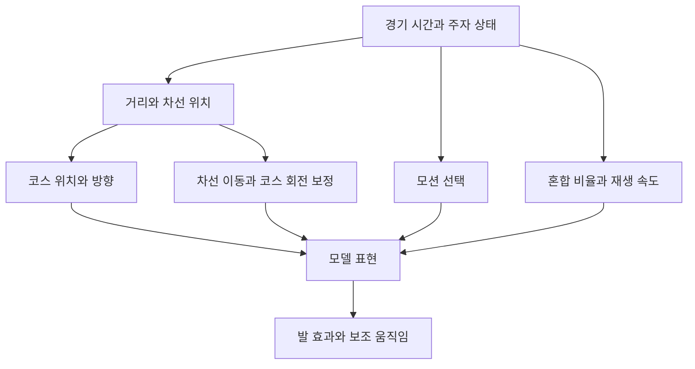
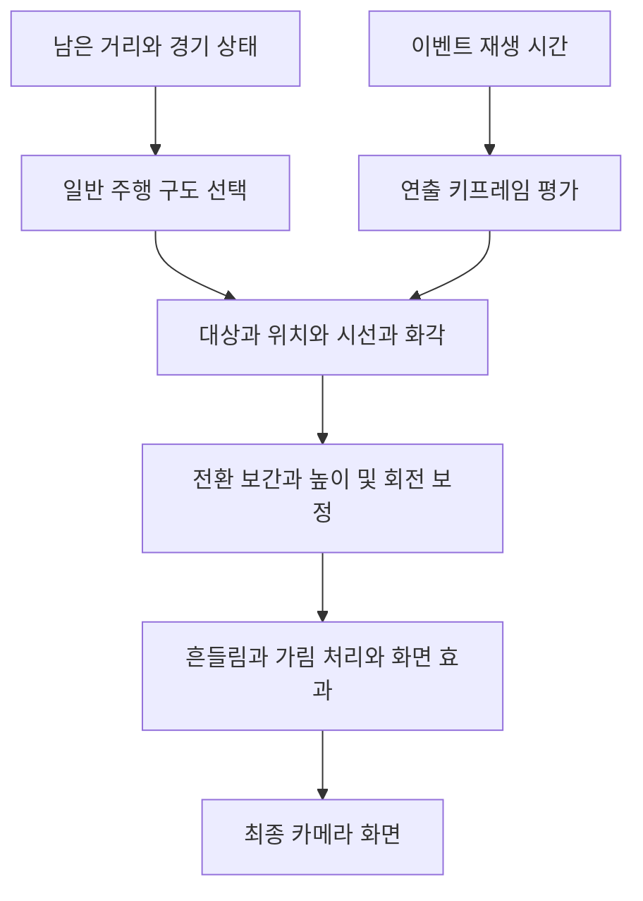

# 우마무스메 달리기와 카메라 구조 분석

- 작성일: 2026-10-18
- 우마무스메 조사 기준: 2026-10-17 한국 PC 설치본
- Project Run 코드 비교 기준: 2026-10-18
- 용도: 동작 원리 학습과 Project Run의 연출 설계 검토
- 상태: 정적 분석과 설계 제안. 프로젝트 적용 완료나 확정 사양을 뜻하지 않는다.

우마무스메의 선언 구조에서 읽을 수 있는 핵심은 **경기 상태, 모델의 달리기 표현, 카메라 연출을 나누어 처리한다는 점**이다. 달리는 자세와 재생 속도를 별도로 제어하고, 차선 이동과 코너에 따른 회전을 보정하며, 발 효과와 카메라가 같은 경기 상태를 참조할 수 있도록 구성되어 있다.

Project Run에는 이미 경기 계산과 표현의 분리, 속도에 따른 애니메이션 재생, 코스 방향을 기준으로 한 카메라 추적이 있다. 우선 검토할 부분은 **카메라 대상 유지와 전환, 코스 구간별 구도, 몬스터의 회전 보정, 발 접촉에 맞춘 효과**다.

## 분석 범위와 근거의 구분

설치 파일의 IL2CPP 메타데이터에서 클래스·필드·함수·매개변수 선언을 읽었으며, 일부 숫자는 형식이 확인된 기본값 테이블에서 추출했다. 게임의 공개용 마스터 데이터 파일에서는 카메라 프리팹 등록 테이블을 확인했다.

| 구분 | 이 문서에서 뜻하는 것 | 예시 |
|---|---|---|
| 확인 | 설치 파일 또는 프로젝트 코드에서 직접 읽은 내용 | 함수 이름과 매개변수, 저장된 float 값, 현재 코드의 조건문 |
| 추론 | 확인된 구조를 연결해 해석한 역할과 의도 | 대상 전환 시간을 이용한 부드러운 추적, 코너 회전의 안정화 |
| 적용안 | Project Run에 맞춘 설계 제안 | 대상 최소 유지 시간, 몬스터별 발 접촉 시점 테이블 |

**우마무스메 함수 본문과 실제 실행 호출 순서는 복원하지 못했다.** 메모리 읽기 제한 이후 추가 프로세스 접근을 중단했으며, 아래 분석은 설치 파일에서 얻은 자료에 한정된다. 선언이 존재한다는 사실만으로 모든 경기 모드에서 실행된다고 볼 수는 없다. 저장된 기본값도 실제 경기에서 최종 적용되는 값과 구분한다.

근거의 요약은 [정적 분석 근거 JSON](우마무스메_정적분석_근거_20261017.json)에 함께 보존했다. 기존 [세로형 레이스 영상 분석](우마무스메_세로형_레이스_영상_분석.md)은 화면 관찰 자료이며, 이 문서의 내부 구조 분석과 구분한다. 그 문서의 세로형 추천을 현재 프로젝트의 화면 방향으로 채택하지 않는다.

## 달리기 처리 구조

### 경기 위치와 모델 표현

`RaceSimulateReader`에는 시간에 대응하는 거리와 차선 위치를 읽는 함수가 있다. `CourseLane`에는 거리에 대응하는 위치·회전과 코스의 뱅크각을 얻는 함수가 있다. 뱅크각은 트랙의 좌우 기울기를 뜻한다.

| 역할 | 확인된 선언 | 해석 |
|---|---|---|
| 경기 데이터 조회 | `SetCurrentTime`, `GetDistance`, `GetLanePositionFromCache` | 특정 경기 시점의 주자 상태를 읽는다. |
| 코스 좌표 조회 | `GetLaneTransform(distance, position, rotation)` | 진행 거리를 코스상의 위치와 방향에 대응시킨다. |
| 코스 기울기 조회 | `GetCourseBankAngle(distance)` | 달리기 표현에 코스의 기울기를 반영할 수 있다. |
| 모델 반영 | `RaceModelController.UpdateTransform`, `CalcFinalRot` | 경기 상태와 코스 방향을 모델 표현에 연결하는 지점으로 해석된다. |

이 구조는 이동 위치와 애니메이션을 따로 관리한다는 해석을 뒷받침한다. 다만 우마무스메의 모든 경기 계산이 클라이언트에서 수행되는지, 루트 모션을 어느 범위에서 사용하는지는 확인하지 못했다.

### 자세 선택과 혼합과 재생 속도

달리기 표현에는 서로 다른 세 가지 담당이 있다.

| 담당 | 클래스와 주요 함수 | 의미 |
|---|---|---|
| 모션 선택 | `HorseMotionSelector.SelectStart`, `SelectRace`, `SelectAfterFinish` | 출발·주행·완주 후에 사용할 모션을 선택하는 인터페이스 |
| 자세 혼합 | `HorseMotionBlendRateCalculator.CalcMotionBlendRate(deltaTime, prevBlendRate)` | 이전 혼합 비율과 경과 시간을 사용해 다음 비율을 계산하는 인터페이스 |
| 재생 속도 | `HorseMotionSpeedCalculator.CalcRunMotionSpeed()` | 모션이 재생되는 빠르기를 별도로 계산하는 인터페이스 |

`RacePlayableAnimation`에는 이전·현재 모션 상태, 믹서 입력 가중치, 크로스페이드 시간, 반복 재생 위치를 다루는 함수가 있다. 따라서 **보통 달리기에서 힘을 주어 달리는 자세로 바꾸는 것과, 발 구르는 박자를 빠르게 하는 것을 따로 제어하는 설계**로 해석할 수 있다.

이전 혼합 비율을 입력으로 받는다는 점은 연속적인 변화를 처리하기 좋은 구조다. 하지만 실제로 선형 보간, 감쇠, 변화량 제한 중 어떤 계산을 쓰는지는 알 수 없다. 모션을 바꿀 때 발의 반복 주기를 어떻게 맞추는지도 미확인이다.

### 확인한 모션 저장값

다음 값은 메타데이터의 기본값 테이블에서 `System.Single` 형식으로 확인했다.

| 클래스 | 필드 | 저장값 |
|---|---|---:|
| `RacePlayableAnimation` | `RUNBLEND_RATE_TIRED` | -1.0 |
| `RacePlayableAnimation` | `RUNBLEND_RATE_NORMAL` | 0.0 |
| `RacePlayableAnimation` | `RUNBLEND_RATE_FAST` | 1.0 |
| `RacePlayableAnimation` | `RUNBLEND_RATE_LASTSPURT` | 1.5 |
| `RaceModelController` | `RUN_SLOW_MOTION_SPEED` | 0.875 |
| `RaceModelController` | `RUN_NORMAL_MOTION_SPEED` | 1.0 |
| `RaceModelController` | `RUN_FAST_MOTION_SPEED` | 1.125 |

블렌드 기준값의 -1과 1.5는 개별 클립에 -100%나 150% 가중치를 준다는 뜻이 아니다. 상태를 구분하는 기준점과 실제 믹서 가중치를 구분해야 한다. 별도 클래스인 `RaceModelController`에는 `RUNBLEND_RATE_MAX = 1.0`도 있으므로, 서로 다른 클래스의 값을 하나의 단순 범위로 합칠 수 없다.

0.875·1·1.125는 모션 속도 관련 저장값이며 주자의 이동 속도 단위인 m/s를 뜻하지 않는다. 재생 속도 상·하한, 주행 방식별 계수, 키에 따른 보정 항목도 있으므로 세 값만으로 최종 재생 속도를 계산할 수 없다.

### 차선 이동과 코너의 회전

`HorseRaceInfoReplay`에는 다음 함수가 분리되어 있다.

- `UpdateRotYByLaneMove(prevLane, curLane, deltaTime)`
- `UpdateRotZByLaneMove(prevLane, curLane, deltaTime)`
- `SetCurveRotZ(courseBankAngleZ, deltaTime)`

설정에는 각 축의 문턱값, 차선 이동량당 회전, 최대 회전량, 초당 회전량, 원래 자세로 돌아오는 회전 속도가 있다. **옆으로 이동할 때의 방향 변화, 몸의 좌우 기울기, 코스 기울기를 나누어 제어**하려는 구조로 해석된다.

이렇게 나누면 차선 변경을 시작할 때 기울고, 이동이 끝나면 다른 속도로 바로 서는 표현이 가능하다. `UpdateSlopeInvRotation`과 보간율 필드도 있어 경사 보정의 별도 처리 가능성을 보여준다. 실제 회전 수식과 각도는 확인하지 못했다.

### 발소리와 먼지와 보조 움직임

발소리에는 좌우 발 콜백과 `ShouldFootSEPlay(index, normalizeTimeWithLoop)`가 있다. `RaceFootSmokeController`에는 발끝 위치 조회, 현재 모션 지정, 반복 재생 위치에 따른 발생 판단, 지면 종류에 따른 효과 선택 함수가 있다.

따라서 발소리와 먼지는 **현재 모션에서 발이 움직이는 박자를 참조해 발생시키는 구조**로 해석할 수 있다. 정확한 접지 시점과 발 접촉 검출 방식은 미확인이다. 별도의 `FootGround` 타입이 있다는 이유만으로 달리기에 발 고정 IK가 적용된다고 단정할 수 없다.

몸·꼬리 스프링, 주행 속도 전달, LOD 갱신도 별도로 존재한다. LOD는 멀리 보이는 모델의 표현 비용을 조절하는 기능이다. 이러한 표현 최적화가 경기 계산의 중단을 뜻하는지는 선언만으로 판단할 수 없다.

### 달리기 구조를 연결한 개념도

아래 연결은 선언을 바탕으로 재구성한 해석이며 실제 호출 그래프가 아니다.



## 카메라 처리 구조

### 일반 주행과 특수 연출

`RaceCameraManager`에는 `Course`, `Event`, `Dynamic` 모드가 있다. 출발·결승·타이틀·결과 카메라도 별도 선언으로 존재한다.

| 구분 | 주요 근거 | 처리 방식에 대한 해석 |
|---|---|---|
| 일반 주행 | `RaceCourseCameraEvent`, `CourseCameraTable` | 남은 거리로 현재 구도 설정을 선택한다. |
| 이벤트 연출 | `EventCamera`, `CameraKeyContainer` | 주자와 라이벌을 연결하고 시간별 키프레임을 평가한다. |
| 역동적 연출 | `DynamicCamera`, `KeyframeCameraPlayer` | 대상 주자를 기준으로 연출을 재생하고 높이·회전을 보정할 수 있다. |

어떤 이벤트가 카메라를 우선 차지하는지, 중단된 연출을 이어 재생하는지 등 실제 우선순위 규칙은 미확인이다.

### 남은 거리에 맞춘 구도 선택

코스 설정에는 `_startDistance`가 있고, 코스 카메라에는 `GetParamIndex(param, restDistance)`, `UpdateIndex(restDistance, forceUpdate)`, `CalcCurrentTime(cameraParam, restDistance, speed)`가 있다. 거리순 정렬과 건너뛴 구간의 설정을 처리하는 함수도 확인했다.

**코스 진행에 맞춰 현재 촬영 구간과 인접 설정을 찾고, 구간 안에서 카메라 파라미터를 평가하는 구성**이라는 근거가 강하다. 속도도 입력으로 받지만 정확한 시간 환산식과 기준 주자는 확인하지 못했다.

거리 기준의 구도표는 레이스가 빨라지거나 느려져도 코너·최종 구간 같은 코스 위치와 연출을 맞추기 좋다. 일반·HalfGate·GI·레이스 ID별 설정과 병합 함수도 있어 기본 코스 연출에 경기별 설정을 더하는 구성으로 해석된다.

### 촬영 대상과 대상 전환

대상 종류에는 `First`, `Last`, `Player`, `OrderDirect`, `IndexDirect`, `Popularity`, `Center`, `PositionCenter`, `JikkyoOrder`, `World` 등이 있다. 이름상 선두·후미·플레이어·지정 순위·인기·무리 중심·중계 대상·고정 공간 위치에 대응하는 것으로 해석된다.

`CalcShiftTargetPosAndDir`는 이전·다음 위치와 방향, 시간, 이동 시간을 받는다. 따라서 촬영 대상을 교체할 때 위치와 시선을 시간에 따라 이동시키는 처리가 가능한 구성이다. `PositionCenter`에는 선두 위치 가중치 항목이 있어 단순 전체 평균 이외의 구도를 지원하려는 의도도 보인다.

대상 위치를 구할 때 차선 기준점 사용 여부와 오프셋을 받는 함수도 있다. 모델의 움직이는 뼈와 별도로 코스·차선 기준점을 사용할 수 있음을 시사한다.

### 위치와 시선과 화각의 독립 제어

카메라 제어 타입에는 `Pan`, `Truck_Standard`, `Truck_Move`, `Fix`, `Drone`이 있으며 각각의 계산 함수가 있다. 촬영 용어에 비춰 시선 회전, 이동 추적, 고정 구도, 공중 이동 구도로 해석할 수 있지만 정확한 좌표계는 미확인이다.

위치, 주시점 오프셋, FOV, 화면 기울기에 각각 보간 함수가 있다. FOV는 카메라가 담는 시야의 각도다. 베지어 제어점 배열과 `Linear`, `EaseIn`, `EaseOut`, `EaseInOut`, 사용자 보간 곡선도 확인했다.

이 구성에서는 **카메라는 주자의 옆에서 앞쪽으로 이동하고, 시선은 얼굴을 유지하며, 화각은 천천히 좁히는 연출**을 만들 수 있다. 위치 경로와 바라보는 점의 경로를 독립적으로 설계하는 것이 핵심이다. 모든 샷이 베지어 경로나 같은 보간 함수를 사용한다는 뜻은 아니다.

### 주자에게 연결하는 키프레임 연출

`EventCamera.PlayByCameraId`는 주자 ID, 라이벌 ID 배열, 카메라 ID 등을 받는다. `KeyframeCameraPlayer`에는 주자·라이벌 오브젝트 연결 함수와 `ApplyTime`, `ApplyPivot`, `ApplyTarget`, `ApplyFov`, `ApplyRoll`, `ApplyShake`가 있다.

`CameraKeyContainer`에는 위치·시선·화각·기울기·흔들림의 키 목록이 나뉘어 있다. 대상 정보에는 상대 위치·머리 위치·회전·크기 항목도 있다. **미리 만든 촬영 동작에 실제 주자를 연결해 재생하는 방식**이라는 해석이 유력하다.

`master.mdb`의 `race_player_camera`에는 `id`, `priority`, `prefab_name`, `category` 열과 122개 행이 있었다. 이는 프리팹을 등록하는 테이블의 행 수이며, 서로 다른 연출 영상이 정확히 122개라는 뜻은 아니다. 이 키프레임 구조가 Unity Timeline 패키지로 구현됐다고 단정할 근거도 없다.

### 추적 보정과 의도한 흔들림

`DynamicCamera`에는 뱅크각 변화 문턱값, 이동 평균 개수, 배율, 회전 보정 함수가 있다. `KeyframeCameraPlayer`에는 대상 높이 보정 함수와 이전 대상 위치·높이 변화 누적 항목이 있다.

**코너의 기울기나 대상 높이 변화가 화면에 갑자기 튀지 않도록 보정하려는 구조**로 해석된다. 실제 필터의 계산식과 평균 구간은 확인하지 못했다.

연출용 흔들림은 카메라 위치, 바라보는 점, 화면의 좌우 기울기로 구분된다. 각 항목에 강도와 주파수가 있으며 Perlin 노이즈 관련 설정도 있다. 안정적인 기본 추적 위에 필요한 흔들림을 조절해서 더하는 설계로 볼 수 있다. 주자의 발 구름을 흔들림 신호로 직접 쓰는지는 미확인이다.

### 가림 처리와 화면 효과

난간·출발 게이트·관중을 숨기는 함수, 다른 주자의 디더 처리, 근거리 클리핑 조절, 시야 범위 계산이 있다. 구도에 따라 화면을 가리는 요소를 관리할 수 있는 구성이다.

DOF, 지면 블러, 방사형 블러, 색 보정, 렌즈 왜곡, 다중 카메라와 분할 화면도 별도 설정으로 존재한다. 어떤 샷에서 활성화되는지와 실제 비용은 확인하지 못했으므로 Project Run의 필수 구현 목록으로 삼지 않는다.

### 확인한 카메라 저장값

| 클래스와 필드 | 저장값 | 해석 범위 |
|---|---:|---|
| `CourseCameraParam.DefaultTargetShiftMoveTime` | 약 1.8 | 대상 전환 시간 관련 기본값. 모든 전환이 1.8초라는 뜻은 아니다. |
| `RaceCameraEventBase.TargetOffsetY` | 1.5 | 대상 높이 관련 저장값. 모델별 최종 주시 높이는 미확인이다. |
| `RaceCameraManager.DEFAULT_FOV` | 10.0 | 기본 화각 관련 저장값. 실제 경기 화면의 고정 화각으로 볼 수 없다. |
| `RaceCameraManager.DEFAULT_NEARCLIP` | 약 0.3 | 기본 클리핑 관련 저장값 |
| `RaceCameraManager.DEFAULT_FARCLIP` | 1500.0 | 기본 클리핑 관련 저장값 |

이 수치를 Project Run의 최적 설정으로 그대로 채택하지 않는다. 특히 좁은 화각은 카메라 거리와 함께 조정해야 하며 몬스터 크기, 경기장 구조, 화면비에 따라 결과가 달라진다.

### 카메라 처리 흐름을 연결한 예시

아래 의사코드는 선언을 바탕으로 한 설명용 구성이다. 원본 코드나 실제 호출 순서를 복원한 것이 아니다.

```text
일반 주행 모드라면
    남은 거리로 현재 구도 설정을 고른다
    설정의 대상 종류에 따라 주자 또는 공간 기준점을 정한다
    구간 진행량에 맞춰 위치와 시선과 화각을 계산한다
특수 연출 모드라면
    연결된 주자와 라이벌을 기준으로 현재 시간의 키프레임을 평가한다

대상 전환과 높이와 회전의 보정을 적용한다
해당 샷에 설정된 흔들림을 더한다
카메라 위치와 방향과 화각을 반영한다
구도에 필요한 표시 상태와 화면 효과를 적용한다
```



## Project Run에서 이미 구현된 기반

다음 비교는 2026-10-18의 소스 코드를 다시 확인한 결과다. 실제 플레이 화면의 품질이나 웹 성능을 측정한 결과는 아니다.

| 영역 | 현재 코드에서 확인한 내용 | 근거 |
|---|---|---|
| 역할 분리 | 경기 계산, 주자 표현, 카메라 클래스가 분리되어 있다. | `Sys_Race`, `RaceRunnerView`, `Sys_RaceCamera` |
| 애니메이션 시간 | 수동 Playables 평가와 보간된 경기 시간에 맞춘 재생이 있다. | `RaceRunnerView.LateUpdate` |
| 달리기 재생 속도 | 몬스터별 기본 재생 속도에 현재 속도 / 기본 이동 속도 비율을 적용한다. | `RunAnimationSpeed`, `ScaleRunAnimationWithSpeed` |
| 모션 혼합 | 기본 Idle/Run 혼합과 선택적 상체 동작 레이어가 있다. | `AnimationMixerPlayable`, `AnimationLayerMixerPlayable` |
| 갱신 순서 | 주자 표현은 실행 순서 -50, 카메라는 100으로 지정돼 있다. | 두 클래스의 `DefaultExecutionOrder` |
| 카메라 추적 | 코스 전방·우측 벡터로 오프셋을 구성하고 화면비·대열 폭에 따라 거리를 조절한다. | `Sys_RaceCamera.LateUpdate` |
| 도로 코스 | 별도 코스가 있는 경우 도로의 앞뒤 위치를 기준으로 구도를 조정한다. | `sim.Course != null` 분기 |
| 연출 복귀 | 스킬 영상 뒤 카메라 위치·회전을 보간해 복귀한다. | `videoBlendRemaining` 처리 |

일반 주시점은 주자 루트 위치에 `CameraFocusHeight`를 더하므로 머리 뼈의 애니메이션을 직접 따라가는 구조가 아니다. 얼굴 클로즈업은 별도 기준점을 사용한다. 이미 있는 안정적인 기준점을 유지하면서 필요한 부분만 개선하는 것이 적절하다.

## 적용할 가치가 큰 개선안

### 촬영 대상 유지와 전환 방식

현재 일반 샷은 4.5초 단위로 순환하고, 경쟁 구도에서는 매 프레임 인접 주자 쌍의 점수를 비교한다. 샷이나 `FocusRunner`가 바뀌면 대부분 컷으로 처리해 오프셋·주시점·화각을 바로 바꾼다. 후보 점수가 자주 뒤집힐 때 화면 전환도 잦아질 가능성이 있다. 실제 증상 재현 여부는 별도 확인해야 한다.

대상 최소 유지 시간, 교체에 필요한 점수 차이, 경쟁하는 두 주자의 유지 상태를 둔다. 구도 설정에는 즉시 컷, 시간을 둔 추적 전환, 크로스페이드를 구분한다. 전체 대열을 보는 구도에서는 선두 ID 변화가 실제 컷을 요구하는지도 따로 판단한다.

### 코스 구간별 구도표

현재 결승 직전에는 남은 거리 조건이 있지만 평상시 구도는 시간 순환이다. 직선·코너·최종 구간에 대응하는 구도표에 추월·스킬 이벤트를 조건부로 끼워 넣는 방식을 검토한다.

`Table_RaceCameraShot` 같은 데이터에는 적용 구간, 대상 방식, 위치·시선 오프셋, 화각, 전환 유형·시간, 우선순위, 최소 유지 시간, 재사용 대기 시간을 둘 수 있다. 이 이름과 항목은 설계 예시이며 신규 코드가 생성된 것은 아니다. Excel을 편집 원본으로 쓰는 경우에는 개발 규칙에 따라 JSON으로 변환하고 메모리에서 조회한다.

### 위치와 시선의 반응 분리

현재 `smoothedLook`는 컷 여부와 관계없이 `focus`를 그대로 받는다. 주로 보간되는 값은 카메라 오프셋과 화각이다. 몬스터의 일반 추적점은 유지하면서 대상 교체나 얼굴 클로즈업의 작은 흔들림에 별도 시선 보정을 적용할 가치가 있다.

빠른 전진 이동 전체를 지연시키면 주자가 화면에서 밀릴 수 있다. 전진 추적, 대상 변경, 애니메이션으로 생기는 국소 흔들림을 구분해서 조절한다.

### 몬스터 회전과 발 효과

현재 `RaceRunnerView`는 몬스터 루트의 로컬 위치·회전을 초기화하고, 뒤의 기울기 처리는 `HasRider` 분기에서 기수에 적용한다. 몬스터만 출전하는 현재 방향에서는 **시각 표현용 자식 루트에 코너와 차선 이동 기울기를 별도로 적용하는 안**을 검토할 수 있다. 경기 거리·차선·충돌 판정에는 영향을 주지 않게 한다.

발소리는 한 주행 주기를 두 구간으로 나누어 발생시키고, 먼지는 시간당 방출량을 사용한다. 몬스터별 발 접촉 시점과 발 위치를 지정하면 접지감이 좋아질 가능성이 있다. 연속적인 잔먼지는 유지하고 접촉 순간의 먼지를 별도로 추가하는 구성도 가능하다.

보통·질주·지침 모션의 추가 혼합은 해당 몬스터에 맞는 클립이 확보된 경우에 검토한다. 우마무스메의 두 발 캐릭터용 수치를 몬스터의 확정 값으로 사용하지 않는다.

### 우선순위

| 순서 | 작업 후보 | 기대하는 변화 | 조건 |
|---|---|---|---|
| 1 | 대상 유지와 컷 및 추적 전환 분리 | 경쟁 대상 변경 때 화면이 불필요하게 튀는 현상을 줄인다. | 고정 입력의 같은 레이스로 전환 횟수와 화면을 비교한다. |
| 2 | 코스 구간별 구도표 | 직선·코너·막판 경쟁에 어울리는 구도를 배치한다. | 경기장별 공간 제약을 반영한다. |
| 3 | 주시점 보정과 몬스터 기준점 정리 | 얼굴 클로즈업과 대상 전환을 안정시킨다. | 큰 체형과 작은 체형을 함께 검증한다. |
| 4 | 몬스터 기울기와 발 접촉 효과 | 차선 이동과 달리기의 무게감을 높인다. | 모델별 축·보폭·발 수에 맞춰 조정한다. |
| 5 | 재사용 가능한 연출 템플릿 | 카메라 동작과 화각 곡선의 조정을 쉽게 한다. | 배속·정지·스킬 영상 복귀의 시간 정책을 먼저 정한다. |

기존 일반 샷 선택은 경기 시간, 오프셋 보간은 실제 프레임 시간, 영상 복귀는 배속에 영향받지 않는 시간을 사용한다. 서로 다른 목적의 시간을 하나로 일괄 치환하지 않는다.

## 현재 씬 구성에 맞춘 적용 범위

| 씬 | 현재 합의된 구성 | 검토 방향 |
|---|---|---|
| `Scene_Oval` | 기존 경기장과 기존 캐릭터 | 대열·추적·경쟁 구도 전환의 기준 검증 씬 |
| `Scene_Prontera` | 신규 경기장과 기존 캐릭터 | 도로 추적을 유지하며 건물·수목·코너별 구도 확인 |
| `Scene_OvalToon` | 기존 경기장과 카툰 캐릭터 | 카툰 몬스터의 크기·얼굴 기준점에 맞춘 구도 확인 |
| `Scene_PronteraToon` | 신규 경기장과 카툰 캐릭터 | 도로 공간과 카툰 체형 조건을 함께 확인 |
| `Scene_2D` | 스프라이트 경기장과 8방향 몬스터 | 대상 유지, 진행도별 화면 구성, 발 효과 타이밍 같은 원리를 별도로 적용 |

`Scene_2D`는 사선 구도·스크롤을 사용하는 별도 표현 체계이므로 3D 카메라 궤도, 뼈 기반 클로즈업, 3D 회전 보정을 그대로 적용하지 않는다. 경기 계산은 공유하되 2D 표현 규칙에 맞게 설계한다.

새 구도에서도 몬스터를 기준으로 프로필·이름표·클로즈업을 연결하고, 1280×720 UI 기준과 Safe Area 관련 프로젝트 규칙을 따른다. 웹 기본 품질인 `PC`·`PC_RPAsset`을 임의로 낮추지 않는다. 다중 카메라 동시 렌더링과 고비용 후처리는 실제 H5 환경 측정 후 판단한다.

## 구현 시 확인할 항목

- 같은 경기 입력에서 카메라·연출 설정을 바꿔도 순위와 완주 판정이 같아야 한다.
- 선두 교체와 경쟁 대상 교체가 반복될 때 불필요한 컷이나 시선 점프가 없어야 한다.
- 직선·코너 진입과 탈출, 결승, 스킬 영상 복귀를 비교한다.
- 배속·정지·건너뛰기·재시작 후에도 오래된 대상과 연출 상태가 남지 않아야 한다.
- 카메라 밖 주자도 같은 경기 계산을 수행해야 한다.
- 큰 몬스터와 작은 몬스터의 얼굴·몸이 잘리지 않는지 확인한다.
- 발 효과는 슬로 모션에서 실제 모션의 접촉 시점과 비교한다.
- 3D 네 씬과 `Scene_2D`를 각각 검증하고, 에디터·웹의 시각적 일치와 실제 기기 성능을 구분해 기록한다.

## 근거와 관련 자료

| 자료 | 사용 범위 |
|---|---|
| [정적 분석 근거 JSON](우마무스메_정적분석_근거_20261017.json) | 핵심 클래스·함수·필드, 모션 기본값, 카메라 기본값, 카메라 등록 테이블 |
| [Project Run 개발 규칙](Project_Run_개발_규칙.md) | 역할 분리, 몬스터 중심 표현, 씬 구성, 테이블·웹 품질·검증 기준 |
| [현재 카메라 코드](../../Assets/Scripts/Game/Race/Camera/Sys_RaceCamera.cs) | 대상 선택, 구도, 보간, 도로 추적, 영상 복귀 비교 |
| [현재 주자 표현 코드](../../Assets/Scripts/Game/Race/Runner/RaceRunnerView.cs) | 모션 시간, 재생 속도, 기울기, 발 효과 비교 |
| [세로형 레이스 영상 분석](우마무스메_세로형_레이스_영상_분석.md) | 화면·UI·연출의 별도 관찰 자료 |

설치본의 주된 원본은 `D:/umamusume/client/umamusume_Data/il2cpp_data/Metadata/global-metadata.dat`와 `D:/umamusume/client/Assets/master/master.mdb`다. 세부 추출 자료는 조사 폴더 `C:/Users/ParkJongYoun/.codex/visualizations/2026/10/17/01a14816-9a88-7cb3-a6f7-000455cd1f21/umamusume_research`에 있다. 원본 메타데이터 해시와 추출 근거의 위치는 동봉 JSON에 기록했다.

메타데이터 구조 판독에는 Il2CppDumper 프로젝트의 `MetadataClass.cs`와 `Il2CppExecutor.cs`를 참고했다. 이 도구의 구조 설명은 바이너리 형식의 근거이며 우마무스메 동작을 직접 설명하는 자료는 아니다.
